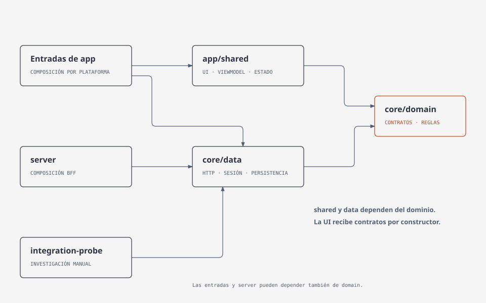
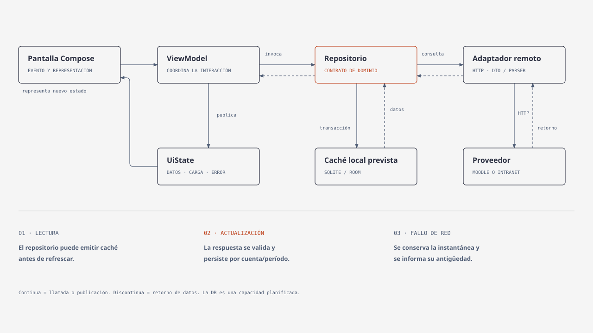
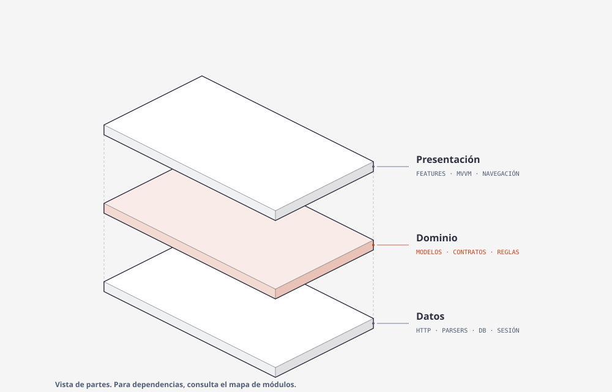
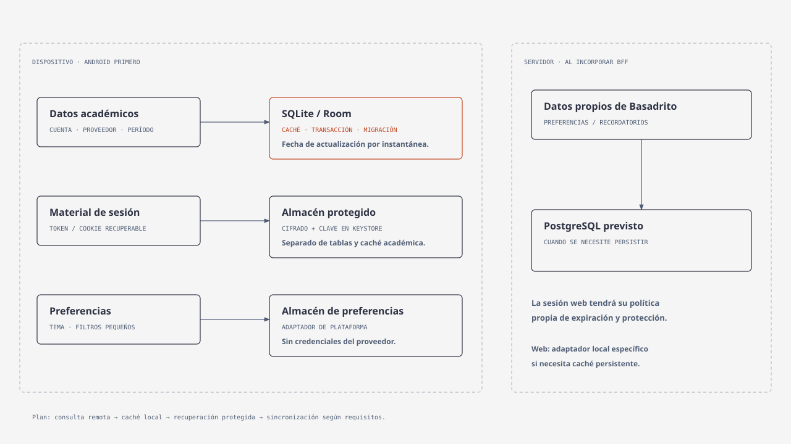

# Basadrito


Aplicación para consultar y organizar la vida académica de estudiantes de la Universidad Nacional Jorge Basadre Grohmann. Integra información de Moodle e Intranet y busca ofrecer una experiencia clara para cursos, notas, asistencia y calendario.

## Contenido

- [Estado y alcance](#estado-y-alcance)
- [Arquitectura](#arquitectura)
- [Estructura del proyecto](#estructura-del-proyecto)
- [Estrategia de datos y DB](#estrategia-de-datos-y-db)
- [Tecnologías y herramientas](#tecnologías-y-herramientas)
- [Comenzar](#comenzar)
- [Pruebas y contribuciones](#pruebas-y-contribuciones)
- [Documentación](#documentación)

## Estado y alcance

El proyecto está en desarrollo. La base de autenticación Moodle/Intranet, la sesión en memoria, la herramienta de comprobación y las pruebas funcionan en JVM.

| Área | Estado |
|---|---|
| Autenticación y comprobación de perfil | Implementadas y probadas en JVM. |
| Herramienta de integración por consola | Disponible para acceso, perfil y consulta de cursos. |
| UI Android y navegación funcional | En construcción; diseño y organización previstos por feature. |
| Caché local y recuperación protegida de sesión | Planificadas; estrategia descrita abajo. |
| Escritorio y web/BFF | Contemplados en la arquitectura; integración posterior. |

## Arquitectura

**Clean Architecture** define los límites y la dirección de dependencias. **MVVM** organiza la presentación. Las pantallas se agrupan por funcionalidad —autenticación, inicio, cursos, notas, asistencia y calendario— dentro de la UI compartida.



`domain` define modelos y contratos propios. `data` implementa esos contratos con HTTP, parsers, sesión y almacenamiento. `shared` representa pantallas y estado. Las entradas de plataforma ensamblan las implementaciones y las entregan por constructor; la UI trabaja con contratos de dominio.

Android y escritorio usarán integración directa con los proveedores. Web consumirá una API propia mediante un **BFF** —servidor que adapta los servicios al cliente web— con sesiones aisladas por usuario.

### De una acción a los datos



El ViewModel transforma acciones en operaciones y resultados en `UiState`. El repositorio decide cómo consultar, actualizar y conservar los datos. Con caché, la DB local permitirá observar una instantánea y mantenerla cuando falle una actualización remota. Los formatos originales se convierten a modelos propios dentro de `data`.

<details>
<summary>Vista axonométrica de las responsabilidades</summary>



Las flechas del mapa de dependencias definen sus conexiones; la posición de estas capas no representa el orden de ejecución.

</details>

Consulta [arquitectura](docs/arquitectura.md) para composición, navegación, comunicación entre plataformas y reglas de sesión.

## Estructura del proyecto

```text
app/
  androidApp/       arranque y composición Android
  desktopApp/       arranque y composición JVM
  webApp/           arranque del navegador
  iosApp/           entrada iOS
  shared/           features, ViewModels, UiState, navegación y diseño
core/
  domain/           modelos, contratos y reglas independientes
  data/             HTTP, proveedores, repositorios y almacenamiento
server/             API propia y composición del BFF
tools/
  integration-probe/ comprobación manual de las integraciones
docs/               arquitectura, guías, diseño y diagramas
```

Cada módulo KMP tiene su `src/commonMain` y fuentes específicas como `androidMain` o `jvmMain`. Estos conjuntos indican dónde puede compilar el código; los paquetes y contratos delimitan responsabilidades. `core` es un directorio agrupador: las dependencias apuntan a `:core:domain` o `:core:data`.

Por lo que se siguen los siguientes lineamentos.

| Funcionalidad| Nombre del módulo |
|---|---|
| Una regla o contrato de consulta | `core/domain` |
| Un endpoint, DTO, parser o repositorio concreto | `core/data` |
| Una pantalla, evento o estado | `app/shared/feature/<feature>` |
| Un componente visual reutilizable | `app/shared/designsystem` |
| Un motor HTTP, permisos o apertura de DB | Composición y fuentes de la plataforma |
| Una ruta HTTP de Basadrito | `server` |

La [guía de estructura KMP](docs/estructura-del-proyecto.md) desarrolla el árbol y el uso de `expect`/`actual`.

## Estrategia de datos y DB



La persistencia se incorporará por responsabilidad:

- **Caché académica local:** SQLite con Room para Android. Guardará datos por cuenta, proveedor y período, con fecha de actualización. Los destinos nativos/JVM compartirán lo compatible; web tendrá su adaptador cuando necesite persistencia local.
- **Sesión:** tokens y cookies recuperables irán en almacenamiento protegido de plataforma, separado de las tablas académicas. En Android se prevé cifrado con claves protegidas por Keystore. La recuperación dependerá de la validez que mantengan los proveedores.
- **Preferencias:** tema y filtros pequeños usarán un almacén de preferencias.
- **Datos propios del BFF:** SQLite se preve cuando existan requisitos de persistencia del servicio, como preferencias entre dispositivos o recordatorios.

La UI podrá mostrar datos almacenados y su antigüedad, actualizar a petición y conservar la última instantánea ante un fallo de red. El acceso inicial exigirá ambos proveedores; una caída temporal posterior permitirá acceso parcial y reintento. La estrategia contempla transacciones, aislamiento por cuenta, migraciones y borrado al cerrar sesión.

Consulta [datos y persistencia](docs/diseno/datos-y-persistencia.md) para esquema inicial, elección de librería, actualización y pruebas previstas.

## Tecnologías y herramientas

| Tecnología / herramienta | Uso | Situación |
|---|---|---|
| Kotlin Multiplatform | Compartir contratos, lógica y adaptadores compatibles | Configurado. |
| Compose Multiplatform + lifecycle | UI declarativa, estado y ViewModels | Base configurada; conexión por features en desarrollo. |
| Ktor Client + kotlinx.serialization | HTTP y conversión de JSON | Integración JVM disponible. |
| Coroutines y Flow | Operaciones asíncronas y estado observable | Coroutines utilizadas; observación de caché prevista. |
| Gradle Wrapper y catálogo de versiones | Compilación y dependencias reproducibles | Configurados. |
| kotlin.test, coroutines-test y Ktor MockEngine | Pruebas de reglas, coordinación y protocolo controlado | Pruebas JVM disponibles. |
| Integration probe + dotenv | Comprobar los proveedores desde consola | Disponible. |
| DevTools / Network | Analizar formularios, solicitudes y redirecciones | Herramienta de investigación. |
| ADB y emulador/dispositivo | Instalar y observar Android | Necesarios al ejecutar la app. |
| Figma | Diseñar flujos, componentes y pantallas | Referencia de diseño del producto. |
| Room / SQLite e inspector SQL | Caché, consultas y migraciones | Propuestos al implementar consulta sin conexión. |
| GitHub Actions | Repetir comprobaciones de build y pruebas | Planificado. |
| WorkManager | Sincronización Android que deba sobrevivir al cierre | Previsto si el requisito lo necesita. |
| Docker Compose y cliente PostgreSQL o SQLite | Entorno local de servicios del BFF | Previstos cuando se incorpore esa persistencia. |

Las librerías se eligen comprobando plataformas y compatibilidad con el catálogo. Empezamos con composición manual e inyección por constructor; incorporaremos otras herramientas cuando resuelvan una necesidad concreta.

## Comenzar

Necesitas un JDK compatible con el wrapper y Android SDK con plataforma **37** para ensamblar Android. La configuración local comprobada y las versiones están en [entorno de desarrollo](docs/desarrollo/entorno.md). Usa el wrapper incluido en el repositorio.

Desde PowerShell, en la raíz:

```powershell
.\gradlew.bat :core:data:jvmTest :tools:integration-probe:classes
.\gradlew.bat :app:androidApp:assembleDebug
```

El primer comando ejecuta las pruebas JVM y compila el probe. El segundo genera el APK debug. Para instalar, conecta un dispositivo o inicia un emulador:

```powershell
adb devices
.\gradlew.bat :app:androidApp:installDebug
```

### Comprobar las integraciones

Copia `.env.example` a `.env` en la raíz y completa tus credenciales localmente. Después:

```powershell
.\gradlew.bat :tools:integration-probe:run
```

El probe informa acceso a Moodle/Intranet, comprobación del perfil y resultado de cursos. Su salida distingue fallos de integración aunque Gradle termine correctamente. `classes` solo compila; `run` ejecuta. Los archivos `.env` y `local.properties` permanecen fuera de Git.

## Pruebas y contribuciones

Para contribuir, entrega una funcionalidad o corrección revisable: describe su comportamiento, añade pruebas de sus reglas y errores, y actualiza el documento afectado. Mantén los contratos independientes de formatos externos y evita imports de implementaciones de `data` en las pantallas y ViewModels compartidos.

La [estrategia de calidad](docs/desarrollo/calidad.md) distingue pruebas de dominio, repositorio, parser, DB, ViewModel y UI. La comprobación manual complementa las pruebas automáticas; no las sustituye. Las fixtures y registros deben estar anonimizados y sin tokens, cookies o contraseñas.

## Documentación

| Documento |Contenido |
|---|---|
| [Arquitectura](docs/arquitectura.md) | Entender límites, composición, navegación y plataformas. |
| [Estructura KMP](docs/estructura-del-proyecto.md) | Ubicar código y comprender conjuntos de fuentes. |
| [Entorno](docs/desarrollo/entorno.md) | Configurar JDK/SDK y ejecutar comandos. |
| [Datos y persistencia](docs/diseno/datos-y-persistencia.md) | Entender DB, caché, recuperación y sincronización. |
| [Autenticación](docs/integraciones/autenticacion.md) | Seguir el flujo Moodle/Campus/Intranet y sus pruebas. |
| [Calidad](docs/desarrollo/calidad.md) | Diseñar pruebas y revisar evidencia. |
| [Diseño y trazabilidad](docs/diseno/proceso-y-trazabilidad.md) | Relacionar requisitos, OOHDM, interfaz, implementación y pruebas. |

Los diagramas siguen el estilo de [diagram-design](https://github.com/cathrynlavery/diagram-design). Cada SVG tiene su HTML editable en la misma carpeta.
