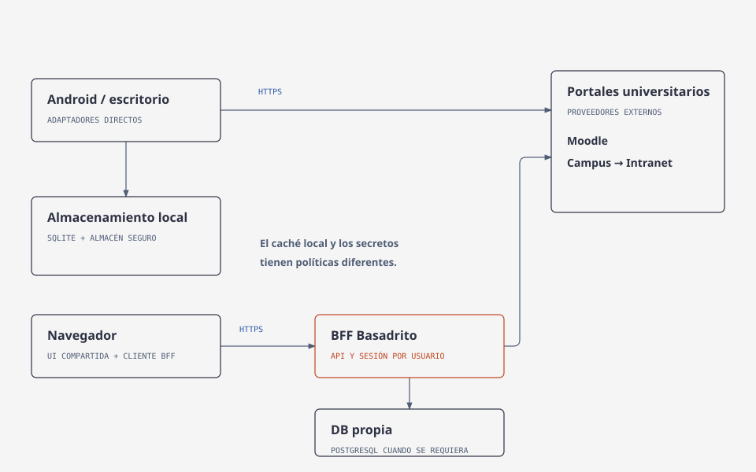

# Arquitectura de Basadrito

## Objetivo y decisiones

Basadrito se organiza en módulos KMP, con límites de Clean Architecture, contratos de dominio y MVVM en presentación. Las funcionalidades se agrupan por feature dentro de esas capas.

Clean Architecture gobierna la dirección de dependencias. MVVM organiza pantalla, estado y coordinación. Los contratos de dominio y sus implementaciones externas siguen la idea de puertos y adaptadores.

## Vista de dependencias objetivo

Las flechas significan «conoce y depende de». Las entradas de plataforma construyen implementaciones de `data` y las entregan a `shared` mediante contratos de `domain`. `shared/commonMain` no importa DTOs, parsers, motores HTTP ni repositorios concretos. El servidor y el probe ensamblan sus propias dependencias.

| Módulo | Responsabilidad | Límite |
|---|---|---|
| `core/domain` | Modelos propios, contratos, estados y reglas de negocio | No depende de Compose, Ktor, SQL ni formatos universitarios. |
| `core/data` | Adaptadores Moodle/Intranet/BFF, repositorios, transporte, sesión y persistencia | Implementa contratos; convierte DTOs, HTML y entidades a modelos propios. |
| `core/database` | Room/SQLite, entidades y transacciones de caché por propietario | Solo destinos nativos/JVM; sin secretos ni dependencia desde presentación común. |
| `app/shared` | Pantallas, ViewModels, UiState, navegación y sistema de diseño | Consume contratos de dominio. |
| Entradas de `app` | Arranque, permisos, ciclo de vida y composición específica de plataforma | Eligen motor HTTP, almacenamiento y repositorios. |
| `server` | API propia de Basadrito, sesiones web y composición del BFF | No contiene lógica de presentación ni expone indiscriminadamente los portales. |
| `tools/integration-probe` | Experimentos manuales de integración | No es una dependencia de producción de las apps. |

Los casos de uso se introducen cuando coordinan una operación con reglas: por ejemplo, refrescar datos de varios proveedores y actualizar caché. No añadimos una clase por cada función que solo reenvía una llamada. Cada repositorio representa una capacidad: autenticación, cursos, notas, asistencia; no un repositorio gigante que absorba todo.

## Vista de las partes

La altura expresa su organización conceptual, no el orden de ejecución ni dependencias. El dominio concentra el vocabulario y las reglas que sobreviven a cambios de UI, HTTP o DB.

## Recorrido de una interacción

Esta vista describe el recorrido de una consulta; la caché de cursos ya tiene implementación. Las llamadas salen hacia el proveedor; los datos regresan normalizados y actualizan el estado de pantalla. No son flechas de dependencias de compilación.

1. La entrada Android crea una sesión por cuenta, clientes HTTP y repositorios. Construye el contenedor que entrega contratos al ViewModel.
2. Una pantalla Compose representa `UiState` y envía eventos, sin llamar directamente a HTTP ni SQL.
3. El ViewModel valida datos de entrada, inicia una coroutine vinculada a su ciclo de vida y publica carga. Invoca un contrato o caso de uso.
4. El repositorio aplica la política de datos. Para el acceso inicial, exige Moodle e Intranet. Para consultas posteriores, usa la sesión activa y conserva acceso parcial ante una caída temporal.
5. El adaptador convierte el protocolo externo a modelos propios. Si hay caché, actualiza la DB dentro de una transacción.
6. El repositorio devuelve un resultado o emite datos observables; el ViewModel publica el nuevo estado y Compose vuelve a representar la pantalla.
7. Cerrar sesión cancela trabajo ligado a la cuenta, invalida la sesión y elimina el acceso protegido y conserva la caché de la cuenta bloqueada hasta una nueva autenticación.

El ViewModel se obtiene con integración de lifecycle; no se crea un cliente o una nueva sesión en cada recomposición. Se empieza con inyección por constructor y composición manual. Koin u otro contenedor solo se incorporará si reduce una complejidad comprobada.

## Plataformas y comunicación

Android y escritorio acceden a los proveedores mediante adaptadores directos. La web usa una API BFF porque el navegador impone condiciones de origen, cookies y acceso diferentes. El BFF comparte contratos y adaptadores que sean adecuados para JVM; mantiene sesiones aisladas por usuario. No se comparte una única sesión global entre visitantes.

El navegador recibe una sesión de Basadrito, no las cookies o tokens de los portales. La propuesta para web es cookie de sesión `HttpOnly`, `Secure`, política `SameSite` justificada y protección CSRF cuando corresponda. Esta política se concretará al implementar el BFF. Los endpoints propios de login, logout y consulta tendrán DTOs y errores públicos documentados.

Las URLs son configuración de los adaptadores/entradas; `App` no recibe una URL BFF por defecto para todas las plataformas. HTTP local de desarrollo y HTTPS de producción se documentan por entorno. No se fija localhost como destino de Android: en el emulador tampoco representa el servidor del equipo.

## DB, almacenamiento y actualización

La caché, la recuperación de sesión y las preferencias tienen adaptadores separados. Android ya ensambla `AndroidSessionStore` para recuperar el token/cookies con cifrado y validación de proveedores; las otras plataformas siguen pendientes. La UI conoce `AuthRepository.restoreSession()`, pero no el archivo ni las cookies. La DB del servidor se incorpora cuando los datos propios requieran persistencia.

La caché de cursos utiliza Room/SQLite en `core/database`, con destinos Android, JVM e iOS. La entrada iOS está preparada y su validación queda pendiente. `core/data` define el puerto de caché, obtiene el propietario desde la sesión y coordina lecturas y actualización; no importa Room. El módulo de DB no se introduce en los fuentes compartidos con JS/Wasm. Web tendrá su propio adaptador cuando lo necesite.

Los cursos guardados incluyen proveedor, ID externo del propietario y fecha de actualización. No se almacena aún una clasificación por período. La UI distingue información actualizada, almacenada y no disponible. El almacenamiento seguro de sesión es una responsabilidad separada de la caché académica. La DB del BFF se propone relacional —PostgreSQL— cuando existan datos propios persistentes: preferencias, recordatorios o sesiones según su política. El primer BFF puede funcionar sin una DB académica central.

Consulta [datos y persistencia](diseno/datos-y-persistencia.md) para esquema inicial, algoritmo de actualización, límites y pruebas.

## Navegación y diseño

La navegación se centraliza en `app/shared/commonMain/navigation` y utiliza [Navigation 3 para Compose Multiplatform](https://kotlinlang.org/docs/multiplatform/compose-navigation-3.html), con el artefacto multiplataforma `navigation3-ui:1.1.1`. Cada feature contiene su pantalla, ViewModel y estado; los componentes reutilizables pertenecen a `designsystem`.

| Archivo | Responsabilidad |
|---|---|
| [AppDestination](../app/shared/src/commonMain/kotlin/org/basadrito/app/navigation/AppDestination.kt) | Rutas tipadas serializables de Inicio, Cursos, Calendario y Ajustes; catálogo de secciones independiente de su presentación. |
| [AppNavigator](../app/shared/src/commonMain/kotlin/org/basadrito/app/navigation/AppNavigator.kt) | Reglas de selección, retorno entre destinos, prevención de duplicados y reinicio del historial al cerrar sesión. |
| [AppNavigation](../app/shared/src/commonMain/kotlin/org/basadrito/app/navigation/AppNavigation.kt) | Barrera de autenticación, pila guardable por cuenta, `NavDisplay` y asociación entre rutas y pantallas. |
| [MainNavigationScaffold](../app/shared/src/commonMain/kotlin/org/basadrito/app/navigation/MainNavigationScaffold.kt) | Barra inferior nativa e insets del sistema. No administra sesión ni crea repositorios. |
| [DashboardRoute](../app/shared/src/commonMain/kotlin/org/basadrito/app/feature/dashboard/DashboardRoute.kt) | Obtiene el ViewModel del destino y observa los cursos. Navigation 3 conserva su estado mientras exista la entrada. |
| [SettingsScreen](../app/shared/src/commonMain/kotlin/org/basadrito/app/feature/settings/SettingsScreen.kt) | Identidad de la cuenta, estado de acceso recordado y cierre de sesión. Incluye apariencia y reintento de conexión; los demás ajustes del diseño siguen pendientes. |

Inicio es la raíz autenticada. Seleccionar Cursos o Ajustes añade su entrada; Atrás o seleccionar un destino previo vuelve a esa entrada sin duplicarla. Inicio y Cursos observan la caché de la cuenta y comparten la actualización del repositorio. Una descarga inicial correcta se reutiliza al abrir el otro destino; la acción manual solicita otra actualización y las solicitudes simultáneas comparten el trabajo. Los decoradores de Navigation 3 conservan estado guardable y ViewModels por entrada. Logout cancela el trabajo de la conexión, reinicia la pila y retira la composición privada. Las rutas no contienen tokens, cookies ni contraseñas.

La recuperación inicial y la evaluación docente se resuelven en `App` antes de construir la navegación privada. Una pila restaurada no concede autenticación: se comprueba el acceso vigente. La composición de navegación está asociada a la cuenta para evitar reutilizar el estado de otra identidad.

La barra inferior procede del nodo Figma `445:1182`: Inicio, Cursos, Herramientas, Calendario y Ajustes. Inicio, Cursos, Calendario y Ajustes tienen destinos operativos. Herramientas está deshabilitado y se anuncia como próximo en accesibilidad. El botón central se dibuja con formas Compose y los iconos son vectores locales, sin URLs de assets en ejecución. Se usan los insets reales del dispositivo, no la barra de estado ni el indicador de inicio dibujados en el mockup.

La navegación lateral se pospone. La separación entre catálogo de secciones, política de pila y contenedor visual permite incorporarla después sin trasladar sesión a la UI ni cambiar las rutas. Tampoco se ha implementado integración con el historial/URLs del navegador web.

Android ensambla su `AppContainer` en `BasadritoApplication` con almacenamiento protegido. Escritorio lo ensambla en [DesktopAppDependencies](../app/desktopApp/src/main/kotlin/org/basadrito/app/DesktopAppDependencies.kt), compartiendo una sesión entre ambos repositorios y cerrándola al terminar la aplicación. La entrada [MainViewController](../app/shared/src/iosMain/kotlin/org/basadrito/app/MainViewController.kt) ensambla la composición iOS. Escritorio conserva cursos y apariencia, pero su sesión sigue en memoria. iOS tiene composición de DB y preferencias preparada; Keychain y validación de plataforma siguen pendientes. La dependencia de datos para esa entrada iOS se limita a `iosMain`, sin introducirla en la presentación común. La entrada web y su composición mediante BFF quedan para otra entrega.

`AcademicSession.close()` libera los clientes y la conexión en memoria al terminar una entrada nativa; conserva cualquier instantánea guardada. `AuthRepository.signOut()` sigue siendo la operación que elimina el acceso protegido. Cerrar una ventana o un controlador no debe convertirse en logout.

| Comprobación | Resultado | Alcance |
|---|---|---|
| Pruebas JVM | 65 aprobadas, 0 omitidas | Repositorios, sesión, Room, agenda personal, agregación académica, descarga autenticada, fallos de almacenamiento, estado de UI, rutas y contraste. |
| Pruebas instrumentadas Android 16 | 12 aprobadas, 0 omitidas | Almacén cifrado, Room, apariencia, navegación, controles fijos, cambio de cuenta y tareas propias entre Inicio y Calendario. |
| Compilación | Correcta | Escritorio, APK y fuentes compartidos JS/Wasm. |
| iOS | Pendiente | Compilación y ejecución. |

El grafo OOHDM describe nodos, contextos y navegación por perfil. El grafo de la aplicación implementa rutas y estado. Se trazan entre sí, pero no son el mismo artefacto. Un estado temporal de error no obliga a inventar una nueva pantalla en Figma.

## Referencias de aprendizaje

- [KMP: conjuntos de fuentes](https://www.jetbrains.com/help/kotlin-multiplatform-dev/multiplatform-discover-project.html).
- [Arquitectura Android](https://developer.android.com/topic/architecture): guía para contrastar separación de responsabilidades y flujo de estado.
Los motivos de diseño y sus alternativas están descritos en este documento y en [datos y persistencia](diseno/datos-y-persistencia.md).
