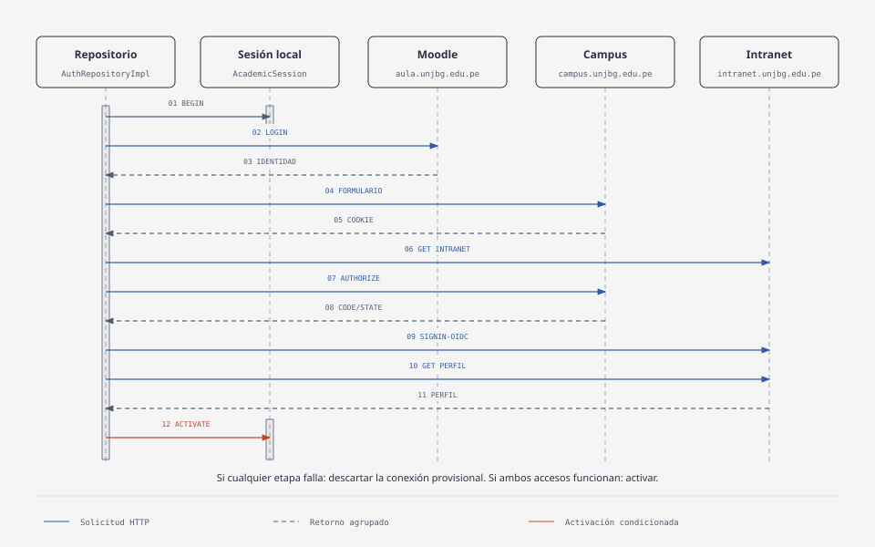

# Autenticación en Moodle e Intranet

## Alcance y regla de acceso

La autenticación está verificada en JVM. El contrato `AuthRepository.signIn()` recibe el usuario y las contraseñas de Moodle e Intranet. El acceso inicial se acepta únicamente si ambos proveedores autentican correctamente y la conexión provisional sigue siendo la actual.

El resultado de dominio contiene `StudentIdentity` e `intranetAvailable`; no contiene tokens ni cookies. La identidad devuelta por el repositorio procede de Moodle. La consulta del perfil de Intranet se usa para verificar acceso y extraer el nombre de esa integración, no para unir automáticamente las identidades.

## Recorrido visual

El diagrama muestra el camino de éxito y agrupa algunas respuestas HTTP. La tabla siguiente conserva los detalles necesarios para entender y reproducir la integración. Si una etapa falla, no se continúa hasta la activación.

## Responsabilidades y archivos

| Componente | Responsabilidad |
|---|---|
| [AuthRepository](../../core/domain/src/commonMain/kotlin/org/basadrito/app/domain/auth/AuthRepository.kt) | Contrato de dominio de inicio y cierre de sesión. |
| [AuthRepositoryImpl](../../core/data/src/commonMain/kotlin/org/basadrito/app/data/repository/AuthRepositoryImpl.kt) | Coordina Moodle e Intranet, activa la sesión o descarta la conexión provisional. |
| [AcademicSession](../../core/data/src/commonMain/kotlin/org/basadrito/app/data/session/AcademicSession.kt) | Custodia la conexión actual y el token Moodle en memoria; rechaza candidatos antiguos. |
| [IntegrationClients](../../core/data/src/commonMain/kotlin/org/basadrito/app/data/di/IntegrationClients.kt) | Crea las fuentes que comparten un cliente HTTP aislado por conexión. |
| [MoodleDataSource](../../core/data/src/commonMain/kotlin/org/basadrito/app/data/moodle/MoodleDataSource.kt) | Obtiene el token, consulta la identidad y valida el identificador del usuario. |
| [IntranetLoginClient](../../core/data/src/commonMain/kotlin/org/basadrito/app/data/intranet/IntranetLoginClient.kt) | Ejecuta formularios, redirecciones, callback y comprobación de perfil. |
| [IntranetSessionParser](../../core/data/src/commonMain/kotlin/org/basadrito/app/data/intranet/parser/IntranetSessionParser.kt) | Reconoce el perfil observado y rechaza un formulario de credenciales. |
| [Probe](../../tools/integration-probe/src/main/kotlin/org/basadrito/tools/Probe.kt) | Comprueba las integraciones por consola; no activa `AcademicSession`. |

## Solicitudes y respuestas

### Moodle

Base: `https://aula.unjbg.edu.pe`.

| Paso | Solicitud | Respuesta y comprobación |
|---|---|---|
| Token | `POST /login/token.php`; campos `username`, `password`, `service=moodle_mobile_app`. | JSON con `token`; debe estar presente y no vacío. Un HTTP 200 no garantiza que Moodle acepte las credenciales. |
| Identidad | `POST /webservice/rest/server.php`; campos `wstoken`, `wsfunction=core_webservice_get_site_info`, `moodlewsrestformat=json`. | JSON con `userid`, `username`, `fullname` y otros datos. Se rechazan respuestas de error y un `userid` no positivo. |

Los DTO representan la respuesta externa. La fuente construye `MoodleSession`; el repositorio convierte la identidad a modelos de dominio. Si falta `fullname`, se usan `firstname` y `lastname` como alternativa. El token permanece en `data`.

### Intranet y Campus

Campus (`https://campus.unjbg.edu.pe`) recibe las credenciales. Intranet (`https://intranet.unjbg.edu.pe`) entrega los datos académicos. Ambos participan en el intercambio de acceso.

| Etapa del cliente | Solicitud | Respuesta y comprobación |
|---|---|---|
| `LOGIN_PAGE` | `GET` a Campus `/login`, siguiendo las redirecciones permitidas. | HTML: extraer `__RequestVerificationToken`, que no debe estar vacío. |
| `CREDENTIALS` | `POST` a Campus `/login`: `UserName`, `Password`, `System=CAMPUS`, `SystemLogin=0` y token antiforgery. | Se permite HTTP 2xx/3xx; el cliente conserva las cookies. Esta respuesta aún no acredita acceso a Intranet. |
| `AUTHORIZATION` | `GET` a la raíz de Intranet y redirecciones de autorización. | HTML del formulario oculto: extraer `code`, `state`, `session_state`. El código de autorización debe existir y no estar vacío. |
| `CALLBACK` | `POST` a Intranet `/signin-oidc` con esos parámetros y `scope=openid profile roles`. | Se permite HTTP 2xx/3xx y se conservan las cookies emitidas. |
| `PROFILE` | `GET` a Intranet `/perfil`, con las cookies del mismo cliente. | Exigir HTTP 200 y perfil reconocido; rechazar un formulario con `UserName` y `Password`. |

Las redirecciones se manejan explícitamente; HTTPS y los hosts Campus/Intranet delimitan los destinos aceptados. Las URLs de autorización y sus parámetros temporales se obtienen en cada ejecución; no se copia una URL de login del navegador como configuración fija.

`isAuthenticated()` repite esa comprobación de `/perfil` sin pedir credenciales. Las cookies del navegador no se comparten con el cliente Kotlin.

## Activación, fallo y cierre de sesión

1. `begin()` descarta la conexión anterior y crea una nueva, inicialmente provisional.
2. El repositorio autentica Moodle y después Intranet, en ese orden. Si Moodle falla, no intenta Intranet.
3. `activate(candidate, moodle)` solo acepta el candidato vigente. Un logout o un nuevo login pueden invalidarlo mientras llegan respuestas.
4. Ante fallo se descarta el candidato y se devuelve un error sin secretos. Ante cancelación se descarta y se propaga `CancellationException`.
5. `signOut()` elimina la referencia de sesión y del token Moodle, y cierra el cliente que custodia las cookies. Esto es cierre local; no implementa revocación del token o logout remoto en los portales.

La sesión es en memoria: no se conserva al reiniciar la aplicación ni se garantiza duración indefinida. La caducidad y recuperación necesitan políticas propias. Tampoco se promete borrado criptográfico de las cadenas de credenciales de la memoria JVM.

Si la contraseña Intranet se pasa vacía al repositorio, el código actual utiliza la de Moodle como alternativa. El probe exige ambas contraseñas no vacías; si son iguales, deben configurarse en los dos campos.

## Reproducción

Desde la raíz del repositorio, en PowerShell:

~~~powershell
.\gradlew.bat :core:data:jvmTest :tools:integration-probe:classes
~~~

Este comando ejecuta pruebas con HTTP simulado y compila la herramienta. No carga `.env` ni consulta las cuentas reales.

Para comprobar una cuenta autorizada, configurar localmente `BASADRITO_USERNAME`, `BASADRITO_MOODLE_PASSWORD` y `BASADRITO_INTRANET_PASSWORD` en `.env` y ejecutar:

~~~powershell
.\gradlew.bat :tools:integration-probe:run
~~~

## Tests

| Archivo de pruebas | Casos | Comportamientos comprobados |
|---|---:|---|
| `IntranetLoginClientTest` | 5 | Formularios, campos, redirecciones, cookies, autorización, perfil y comprobación posterior de sesión; rechazo HTTP y login devuelto con HTTP 200. |
| `AuthRepositoryTest` | 3 | Éxito conjunto; rechazo de Moodle/Intranet y transporte; cancelación y cierre del cliente provisional. Un caso recorre varias variantes de fallo. |
| `AcademicSessionTest` | 3 | Cambio de cuenta sin heredar token/cookies; logout con activación tardía; candidato antiguo incapaz de descartar la cuenta nueva. |
| `IntranetSessionParserTest` | 2 | Nombre extraído sin asumir código/correo; rechazo de HTML vacío, similar, comentado, en script o perteneciente al login. |

## Extras

El HTML está basado en las convenciones de secuencia y el estilo predeterminado de [diagram-design](https://github.com/cathrynlavery/diagram-design) y exportado a SVG.
